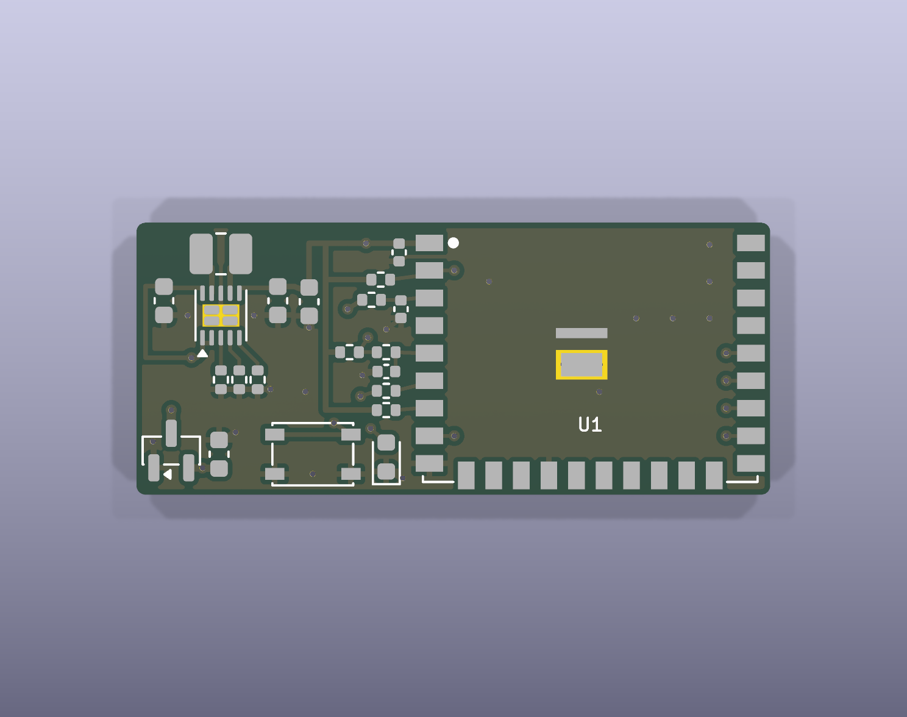
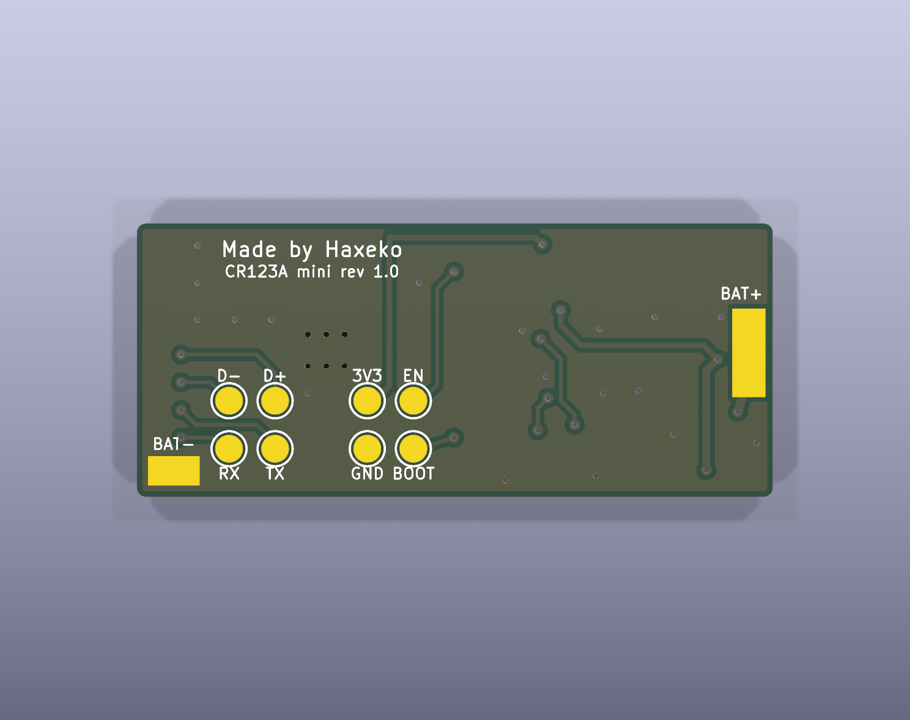
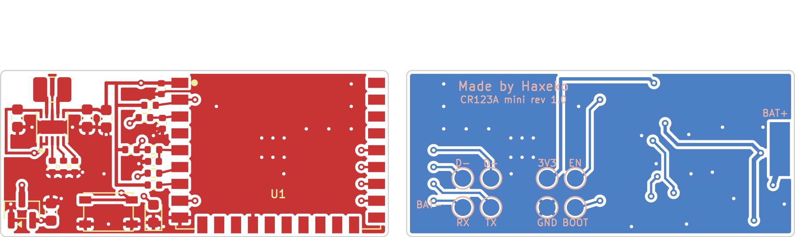

# Bo module-cr123a-mini: nút nhấn Matter dài đúng một viên CR123A

Bản gọn của [`module-cr123a`](../module-cr123a/README.md): bo **dài 34,5 mm, bằng chiều dài pin CR123A**, cao 14,8 mm. Anten module chìa ra 6 mm ở mép trên, **cả cụm 34,5 × 20,8 mm**. Pin **không nằm trên bo**: pin đặt sau bo, trong ngăn pin của vỏ; hai tiếp điểm của vỏ nối dây vào hai pad **BAT+ / BAT−** ở hai đầu mặt dưới bo.

Mọi file được sinh bằng các script dùng chung trong [`../scripts`](../README.md) từ [`design.py`](design.py), rồi kiểm tra bằng KiCad 9.0.9:

- **ERC: 0 lỗi, 0 cảnh báo.**
- **DRC: 0 vi phạm, 0 pad chưa nối, 0 lỗi footprint, 0 lệch giữa PCB và schematic.**
- **Mọi đường mạch đều vẽ tay** trong `design.py`, không qua FreeRouting: sinh lại lúc nào cũng ra đúng bo này.

Chưa đặt mạch, chưa đo trên bo thật. Firmware: **`sdkconfig.defaults.cr123a_mini`**, không dùng bản `cr123a` vì LED và chân đo pin khác (mục 2).

| Mặt trên | Mặt dưới |
|---|---|
|  |  |

Đồng và silkscreen (mặt dưới nhìn từ dưới lên, đã lật):

## 1. Khác bo module-cr123a

| | `module-cr123a` | `module-cr123a-mini` |
|---|---|---|
| Bo / cả cụm có anten | 42,4 × 27,5 / 42,4 × 33,5 mm | **34,5 × 14,8 / 34,5 × 20,8 mm** |
| Pin | trong đế Bulgin BX0123 ở mặt dưới bo | trong vỏ, sau bo; tiếp điểm của vỏ nối dây vào pad BAT+ / BAT− |
| Lắp ráp | linh kiện mặt trên, đế pin mặt dưới | **chỉ mặt trên**; mặt dưới chỉ có đồng: 2 pad pin, 8 pad test |
| LED / đo pin | GPIO22 (chân 15) / GPIO1 (chân 27, ADC1_CH0) | **GPIO11 (chân 6) / GPIO4 (chân 3, ADC1_CH3)** |
| Đo dòng | cầu hàn JP1 (pin), JP2 (3,3 V) | **mắc ampe kế nối tiếp dây BAT+**; không có JP1, JP2 |
| Tụ VBAT | C1 100 µF 1206 | C1 22 µF 0603 (cùng mã với C4) |
| C7 (tụ EN, không lắp) | có footprint | bỏ (module đã có RC trên EN) |
| Pad test | 10 (thêm VBAT, VBAT_SENSE) | 8: 3V3, GND, TX, RX, EN, BOOT, USB D−, D+ (VBAT đo ở C1, VBAT_SENSE ở C9) |
| Firmware | `sdkconfig.defaults.cr123a` | `sdkconfig.defaults.cr123a_mini` |
| Tuổi pin dự tính | ~30 tháng (SIT), ~41 tháng (LIT) | như bản kia: cùng pin, cùng mạch |

## 2. Vì sao đổi chân LED và đo pin

Mọi linh kiện phải nằm ở mặt trên, trong vùng 15 × 14,2 mm bên trái module. Chân 15 (GPIO22) nằm ở cạnh dưới module, sát mép dưới bo, không còn chỗ thoát dây. Chân 27 (GPIO1) nằm ở cạnh phải module, xa phần mạch. Bo này chỉ dùng các chân ở cạnh trái module:

| Chân module | GPIO | Dùng cho |
|---|---|---|
| 1 | 3V3 | nguồn, C6 |
| 2 | EN | R4, pad test EN |
| 3 | **GPIO4 (ADC1_CH3)** | **đo pin**: R9 1 MΩ từ VBAT, C9 100 nF |
| 5 | GPIO10 | nút (LP IO, đánh thức EXT1), như các bo khác |
| 6 | **GPIO11** | **LED**: R8 1 kΩ → D1 |
| 7 | GPIO8 | R5 kéo lên (strapping) |
| 8 | GPIO9 | BOOT, pad test |

GPIO4 là chân JTAG MTCK. Lúc chạy, driver ADC đặt chân ở chế độ analog (không có điện trở kéo), và trong Light-sleep firmware cô lập mọi GPIO. Chỉ lúc khởi động hay Deep-sleep, nếu chân có điện trở kéo mặc định thì tốn tối đa vài µA qua R9: cần đo (checklist, mục P). GPIO11 là LP IO thường, không phải chân strapping hay JTAG.

## 3. Thông số bo

| Mục | Giá trị |
|---|---|
| Kích thước | **34,5 × 14,8 mm**, góc bo R0,5; anten module nhô 6 mm khỏi mép trên → **34,5 × 20,8 mm**; không có lỗ |
| Lớp | 2 lớp FR-4 1,6 mm, đồng 1 oz |
| Đường mạch | 0,2 mm tín hiệu, 0,25–0,5 mm nguồn; khe hở ≥ 0,2 mm; via 0,6 / 0,3 mm phủ mask |
| Cách mép bo | đồng ≥ 0,3 mm |
| Bề mặt | ENIG khuyến nghị (WSON bước 0,5 mm, pad hàn dây) |
| Linh kiện | **mặt trên tất cả** (lắp ráp một mặt) |
| Mặt dưới | pad BAT+ 1,8 × 4,8 mm (đầu trái), pad BAT− 2,8 × 1,6 mm (đầu phải, nằm trong vùng phủ GND), 8 pad test Ø1,5 mm dưới module, phủ đồng GND |

## 4. Bố trí

| Vùng (nhìn từ mặt trên) | Linh kiện |
|---|---|
| Góc trên trái | TPS63900: L1 phía trên, C3 (VIN) bên trái, C4 (3V3) bên phải, R1–R3 phía dưới; cùng đường mạch như các bo khác, xoay 180°. C5 bên phải, rồi trục 3V3 theo mép trên tới chân 1 |
| Cạnh trái module | mỗi chân một hàng: C6 (chân 1), R4 (chân 2), R9 + C9 (chân 3), R7 + C8 + R6 (chân 5), R8 (chân 6), R5 (chân 7); nhánh 3V3 dọc ở x = 10,3 mm |
| Dải dưới, trái | Q1 + C1: đầu vào pin, ngay trên pad BAT+ (mặt dưới) và cạnh đầu vào TPS63900 |
| Dải dưới, giữa | SW1, LED D1 bên phải nút |
| Mặt dưới | BAT+ ở đầu trái, BAT− ở đầu phải; pad test dưới module; BTN_SW, LED_A, VBAT và các đường tới pad test đi ở mặt dưới |

Tọa độ (mm, gốc ở góc trên trái, nhìn từ mặt trên; nhìn từ mặt dưới thì trái/phải đảo lại):

| Vật | Tọa độ |
|---|---|
| Tâm nút SW1 (thân 4,2 × 3,2 mm) | (9,6; 12,6) |
| Tâm LED D1 | (13,6; 12,75) |
| Pad BAT+ (mặt dưới) | tâm (1,3; 7,0), 1,8 × 4,8 mm |
| Pad BAT− (mặt dưới) | tâm (32,5; 13,4), 2,8 × 1,6 mm |
| Pad test, hàng trên (y = 9,6) | x = 19,5 EN · 22,0 3V3 · 27,0 USB D+ · 29,5 USB D− |
| Pad test, hàng dưới (y = 12,2) | x = 19,5 BOOT · 22,0 GND · 27,0 TXD0 · 29,5 RXD0 |
| Module | thân x = 15,7 … 33,7, y = −6 … 14; mép anten y = −6, chân anten y = 0 (mép bo) |

## 5. Lắp vào vỏ

- **Pin nằm sau bo** (phía mặt dưới), trục pin song song cạnh dài của bo. Ngăn pin và hai tiếp điểm (lò xo cho cực −, tấm phẳng cho cực +) thuộc vỏ. Hàn dây từ tiếp điểm + vào **pad BAT+ (đầu trái)**, từ tiếp điểm − vào **pad BAT− (đầu phải)**: hai pad nằm đúng hai đầu pin, dây ngắn.
- **Lót cách điện** (Kapton, tấm nhựa 0,1–0,2 mm) giữa mặt dưới bo và pin: vỏ thép của CR123A là cực −, mặt dưới bo có pad test và pad pin để hở đồng.
- **Lắp ngược pin** vẫn an toàn nhờ Q1. Nên làm vỏ chỉ cho pin lắp một chiều (cực + lõm vào), đỡ phải tháo ra lắp lại.
- **Anten**: giữ pin ở phía dưới, sao cho mép trên của pin không vượt quá mép trên của bo, vì vỏ pin là kim loại. Không đặt kim loại trong ~15 mm quanh anten. Đo RSSI/LQI của parent khi đã đóng vỏ (checklist mục C).
- **Đo dòng**: tháo dây BAT+ khỏi pad và mắc ampe kế (PPK2, Joulescope) vào giữa (checklist mục F). Không có JP1/JP2 như các bo khác.
- **Nạp firmware**: dùng pogo-pin vào các pad test ở mặt dưới **trước khi lắp vào vỏ**, cấp nguồn bằng pin hoặc nguồn 3,0 V vào BAT+/BAT−.

## 6. Đặt mạch và lắp ráp

1. **PCB**: tải `fab/matter-button-module-cr123a-mini-gerber.zip` lên JLCPCB/PCBWay: 2 lớp, 1,6 mm, ENIG.
2. **Lắp ráp JLCPCB (tùy chọn, một mặt)**: chọn lắp mặt trên với `fab/bom-jlcpcb.csv` và `fab/cpl-jlcpcb.csv`: 10 loại Basic, 4 loại Extended (U2 C1518762, L1 C391305, R1 C49010116, SW1 C116501). Kiểm tra góc xoay ở bản xem trước (U2, Q1, D1, L1, SW1).
3. **U1 hàn tay** (LCSC không có), như các bo khác.
4. Hàn dây pin (mục 5), nạp firmware bản `cr123a_mini` ([README chính mục 8](../../README.md#8-build-flash-commissioning-windows-powershell)), chạy [checklist](../../docs/test-checklist.md) (mục P cho bo này).

## 7. File

| File | Nội dung |
|---|---|
| `design.py` | nguồn duy nhất của bo: mạch (thay đổi so với `../scripts/circuit.py`), viền bo, vị trí, toàn bộ đường mạch, via, chữ in |
| `matter-button-module-cr123a-mini.kicad_pro/.kicad_sch/.kicad_pcb` | dự án KiCad 9 |
| `lib/` | symbol + footprint ESP32-H2-WROOM-02C, power symbol VBAT, footprint `CR123A_WirePads` (hai pad nối dây, sinh bởi `gen_project.py`) |
| `fab/` | Gerber, `bom.csv`, `bom-jlcpcb.csv`, `cpl-jlcpcb.csv`, `bom-vi.csv` |
| `docs/` | schematic.pdf, bản vẽ lắp ráp, ảnh render 3D và layout 2D |
