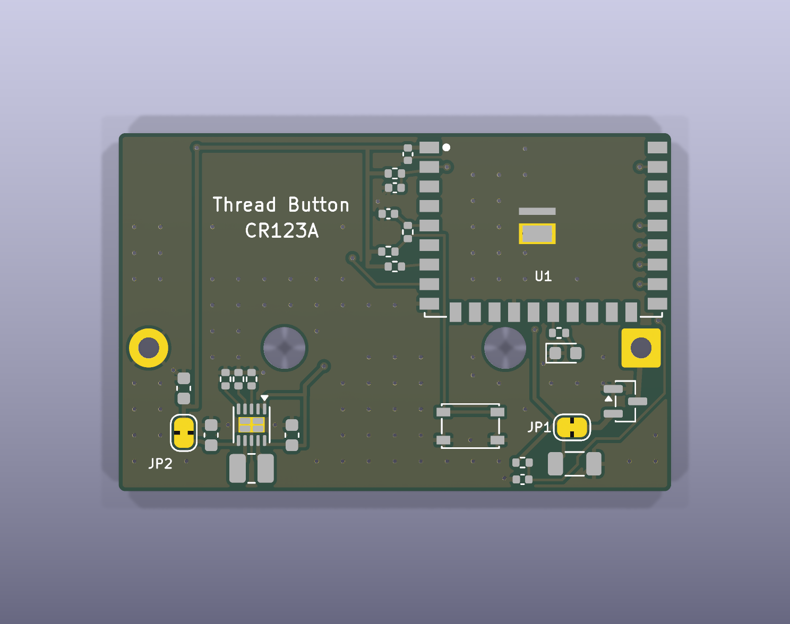
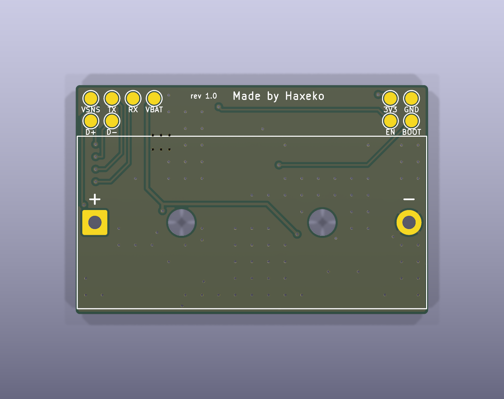
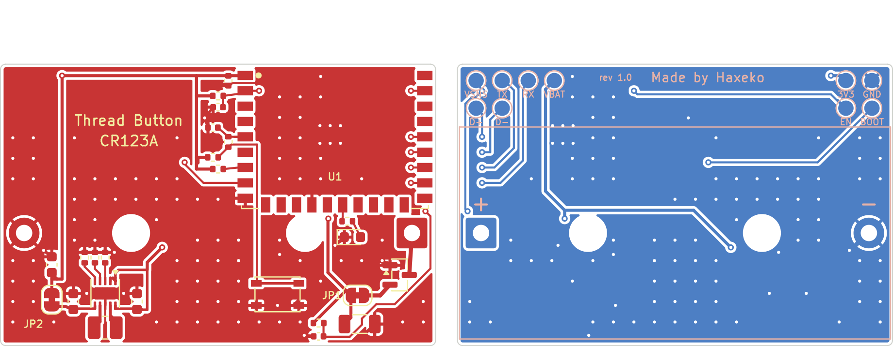

# Bo module-cr123a: nút nhấn Matter, ESP32-H2-WROOM-02C, pin CR123A

Dự án KiCad 9 của mạch trong [README chính](../../README.md) (mục 2–4), với **một pin CR123A (1500 mAh, IEC CR17345)** trong đế **Bulgin BX0123** (xuyên lỗ) ở mặt dưới. Gồm schematic, PCB 2 lớp đã đi dây và file sản xuất. Mọi file được sinh bằng các script dùng chung trong [`../scripts`](../README.md) từ một nguồn duy nhất là [`design.py`](design.py), rồi kiểm tra bằng KiCad 9.0.9:

- **ERC: 0 lỗi, 0 cảnh báo.**
- **DRC: 0 vi phạm, 0 pad chưa nối, 0 lỗi footprint, 0 lệch giữa PCB và schematic** (`kicad-cli pcb drc --severity-all --schematic-parity`).

Chưa đặt mạch, chưa đo trên bo thật: kiểm tra lại footprint module và đế pin (cực tính, vị trí chốt định vị) với datasheet trước khi đặt, và chạy [checklist](../../docs/test-checklist.md) khi có bo. Firmware: thêm `sdkconfig.defaults.cr123a` (Kconfig `BATTERY_CR123A`, [README chính mục 8.2](../../README.md#82-build)).

| Mặt trên | Mặt dưới |
|---|---|
|  |  |

Đồng và silkscreen (mặt dưới nhìn từ dưới lên, đã lật):

## 1. Khác gì bo CR2450

| | module-cr2450 | module-cr123a |
|---|---|---|
| Pin | CR2450, 620 mAh, Ø24,5 × 5,0 mm | CR123A, 1500 mAh, Ø17 × 34,5 mm |
| Điện trở trong | ~8–30 Ω (tăng dần theo đời pin, gấp đôi khi lạnh) | dưới 1 Ω gần suốt đời pin, chịu xung 1–2 A |
| Đế pin | Keystone 3008, dán, mặt dưới | Bulgin BX0123, xuyên lỗ (2 chân + 2 chốt định vị Ø3,2 mm), mặt dưới |
| Tụ bulk trên VBAT | 2 × 220 µF 1210 (~260 µF hiệu dụng) | **1 × 100 µF 1206** (+ 10 µF ở VIN của TPS63900) |
| Bo | 37,4 × 30,5 mm | 42,4 × 27,5 mm |
| Tuổi pin dự tính (SIT / LIT, 20 lần/ngày) | ~11 / ~15 tháng | ~30 / ~41 tháng |

**Vì sao chỉ 1 × 100 µF:** mô phỏng `tools/capsim.py` (điện trở trong CR123A ~0,2 Ω khi mới, ~2 Ω khi gần cạn, [AS]) cho áp pin thấp nhất ≥ 2,55 V khi khởi động hay nối lại Thread ở mọi trạng thái pin tới −10 °C, **có hay không có tụ 100 µF**: không cần dàn tụ bulk như pin cúc áo. Tụ 100 µF chỉ để lọc gần đầu vào (đường VBAT dài ~40 mm từ cực + tới TPS63900). Vẫn cần TPS63900: CR123A chỉ 2,8–3,1 V khi có tải, dưới mức tối thiểu 3,0 V của ESP32-H2.

**Pin sạc RCR123A / 16340 (Li-ion 3,7–4,2 V) không dùng được với đo pin:** TPS63900 chịu tới 5,5 V nên mạch vẫn chạy, nhưng VBAT_SENSE vượt dải ADC 3,3 V (không có cầu chia), và các ngưỡng pin là của Li-MnO2. Bản LiFePO4 3,2 V thì đọc được nhưng % pin sai.

## 2. File

| File | Nội dung |
|---|---|
| `design.py` | nguồn duy nhất của bo: pin, tụ bulk, viền bo, vị trí linh kiện, đường mạch vẽ tay, via, chữ in |
| `matter-button-module-cr123a.kicad_pro/.kicad_sch/.kicad_pcb` | dự án KiCad 9 (mở bằng KiCad ≥ 9.0) |
| `lib/matter_button.kicad_sym`, `lib/matter_button.pretty/` | linh kiện riêng: symbol + footprint ESP32-H2-WROOM-02C, power symbol VBAT, đế Bulgin BX0123 (bản sửa: bỏ dấu "+" in ngoài thân đế, sẽ nằm ngoài bo) |
| `fab/matter-button-module-cr123a-gerber.zip` | Gerber (RS-274X, không thuộc tính X2) + khoan Excellon (cả lỗ không mạ của chốt định vị) |
| `fab/bom-vi.csv` | BOM tiếng Việt, kèm từ khóa tìm mua, mã LCSC và linh kiện thay thế |
| `fab/bom-jlcpcb.csv`, `fab/cpl-jlcpcb.csv` | BOM và file vị trí linh kiện cho dịch vụ lắp ráp JLCPCB; không có U1, BT1 (hàn tay) |
| `fab/bom.csv` | BOM đầy đủ (MPN, mã LCSC, mô tả), C7 ghi DNP |
| `docs/` | schematic.pdf, bản vẽ lắp ráp, ảnh render 3D và layout 2D |

## 3. Thông số bo

| Mục | Giá trị |
|---|---|
| Kích thước | **42,4 × 27,5 mm**, góc bo R0,5; anten module chìa ra 6 mm ở mép trên → cả cụm **42,4 × 33,5 mm**; không có lỗ bắt vít (2 lỗ Ø3,2 mm là chốt định vị của đế pin) |
| Lớp, đường mạch, via, bề mặt | như bo CR2450: 2 lớp FR-4 1,6 mm; 0,2 / 0,3 / 0,4 mm; via 0,6 / 0,3 mm phủ mask; HASL hay ENIG đều được (không có pad tiếp xúc trực tiếp với pin) |
| GND | phủ đồng cả hai mặt, via khâu |
| Linh kiện | mặt trên tất cả, đế pin BT1 ở mặt dưới (chân hàn ở mặt trên); 10 pad test ở mặt dưới, dải phía trên đế pin |

## 4. Bố trí

| Vùng | Linh kiện | Lý do |
|---|---|---|
| Mép trên, bên phải | U1, vùng anten 6 mm **nhô ra ngoài mép bo** | như bo CR2450 |
| Trái module | C6, R4, C7 (không lắp), C8, R7, R6, R5: cùng vị trí so với module như bo CR2450 | trục 3V3 theo mép trên tới chân 1, nhánh x = 19,1 mm cho các điện trở kéo lên |
| Hàng y = 16,5 mm (dưới module) | 2 chân và 2 chốt định vị của đế pin: cực − x = 2,3, chốt x = 12,725 và 29,675, cực + x = 40,1 | đế pin dài 41,3 mm: hàng lỗ phải nằm dưới module (module rộng 18 mm không lọt giữa hai chốt) |
| Dải dưới, trái | TPS63900 + R1–R3, L1, C3, C4; C5, JP2 | cùng bố trí và đường mạch như bo CR2450; 3V3 lên giữa cực − và chốt trái |
| Dải dưới, giữa | SW1 (đường nút xuống từ lề trái module, giữa hai chốt) | |
| Dưới module, phải chốt phải | R8, D1 (GPIO22, chân 15) | |
| Dải dưới, phải | Q1, JP1, C1 100 µF, R9 + C9 đo pin | cực + (chân vuông) → Q1 → JP1 → C1 → VBAT |
| Mặt dưới | thân đế pin (nhựa) chiếm y = 6,5 … 26,5; 10 pad test ở dải y < 6 | đi dây ở mặt dưới dưới thân đế được (thân nhựa) |

Các đường của TPS63900, trục 3V3, quanh module, nút, LED, đầu vào pin và phần lớn đường tới pad test vẽ tay trong `design.py`; các kết nối còn lại (VBAT từ JP1/C1 tới TPS63900, R9 và TP9; VBAT_SENSE tới chân 27 và TP10; BOOT tới TP6) do FreeRouting đi. Mỗi lần chạy `route` có thể ra đường khác; `gen_fab.py` chỉ xuất khi DRC sạch.

Tọa độ (mm, gốc ở góc trên trái, nhìn từ mặt trên):

| Vật | Tọa độ |
|---|---|
| Tâm nút SW1 (thân 4,2 × 3,2 mm) | (27,0; 22,5) |
| Tâm LED D1 | (34,3; 16,9) |
| Đế pin BT1 (mặt dưới) | thân x = 0,55 … 41,85, y = 6,5 … 26,5; trục pin y = 16,5; cực + (chân vuông) x = 40,1, cực − x = 2,3 |
| Pad test, góc trên trái | y = 1,6: x = 2,00 GND · 4,54 3V3; y = 4,3: x = 2,00 BOOT · 4,54 EN |
| Pad test, góc trên phải | y = 1,6: x = 32,96 VBAT · 35,50 RXD0 · 38,04 TXD0 · 40,58 VBAT_SENSE; y = 4,3: x = 38,04 USB D− · 40,58 USB D+ |
| Cầu hàn đo dòng JP1 / JP2 | (34,8; 22,6) / (5,0; 23,02) |
| Module | thân x = 23,6 … 41,6, y = −6 … 14; mép anten y = −6 |

Trục pin cách chân anten 16,5 mm, thân pin (Ø17) cách 8 mm: xa anten hơn bo CR2450. Không đặt kim loại trong ~15 mm quanh anten khi làm vỏ.

## 5. Đặt mạch và lắp ráp

1. **PCB**: tải `fab/matter-button-module-cr123a-gerber.zip` lên JLCPCB/PCBWay: 2 lớp, 1,6 mm, các mục khác để mặc định.
2. **Lắp ráp JLCPCB (tùy chọn)**: lắp mặt trên với `fab/bom-jlcpcb.csv` và `fab/cpl-jlcpcb.csv`. Cùng linh kiện như bo CR2450, trừ C1 = Samsung CL31A107MQHNNNE 100 µF 6,3 V 1206 (C15008); không có C2. Kiểm tra góc xoay ở bản xem trước (U2, Q1, D1, L1, SW1). C7 không lắp.
   - **U1 và BT1 hàn tay.** BT1: đặt đế ở mặt dưới (chốt nhựa vào hai lỗ Ø3,2), hàn 2 chân ở mặt trên. **Kiểm tra cực tính**: chân vuông (pad 1, dấu "+" in ở mặt dưới) là cực +; đối chiếu với ký hiệu trên thân đế trước khi hàn.
3. **JP1, JP2**: cầu hàn đo dòng như bo CR2450.
4. Nạp firmware bản `cr123a` ([README chính mục 8](../../README.md#8-build-flash-commissioning-windows-powershell)), chạy [checklist](../../docs/test-checklist.md).

## 6. Ghi chú thiết kế

- **Bulgin BX0123**: footprint chuẩn của KiCad (`Battery:BatteryHolder_Bulgin_BX0123_1xCR123`), pad 1 (vuông) là cực +. Bản trong `lib/` chỉ bỏ dấu "+" in ở x = −4 mm (ngoài thân đế, sẽ nằm ngoài bo); dấu + / − in lại ở mặt dưới cạnh hai chân.
- Không có vùng cấm đồng cho pin (pin nằm trong thân nhựa, không chạm bo). Đi dây ở mặt dưới dưới thân đế được.
