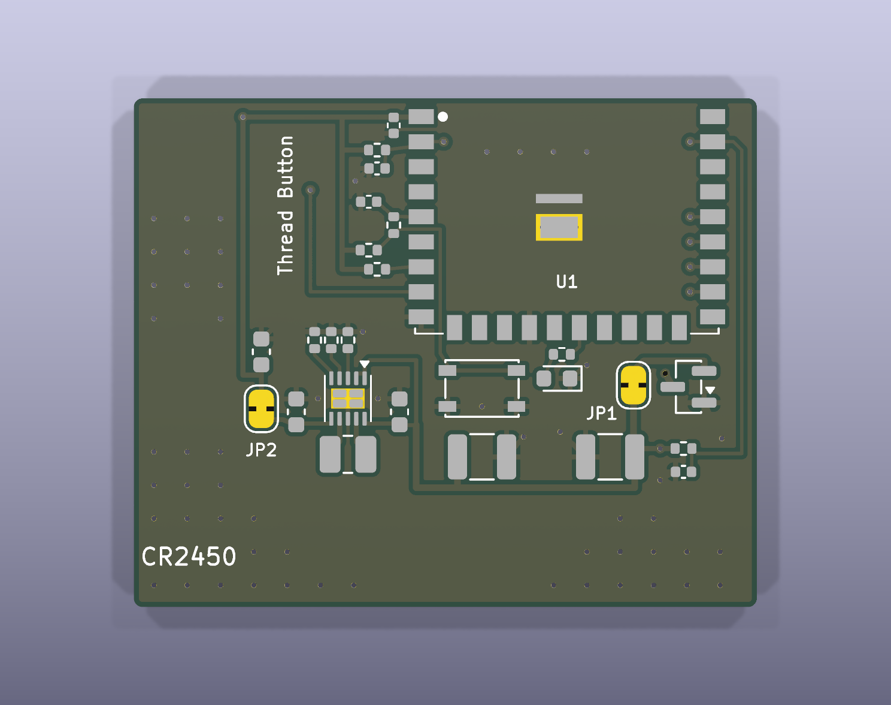
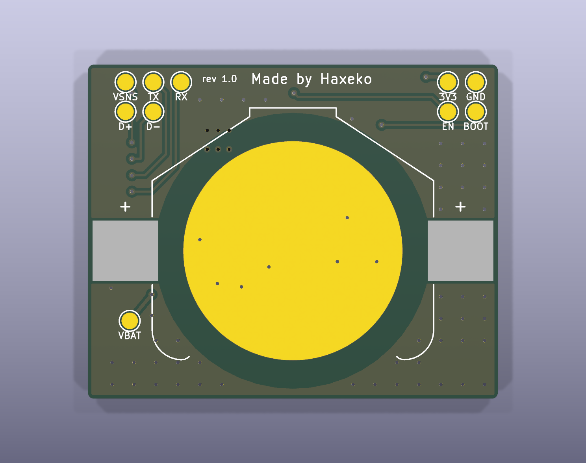
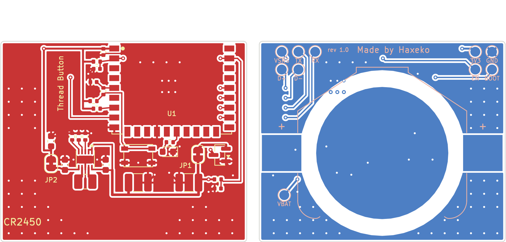

# Bo module-cr2450: nút nhấn Matter, ESP32-H2-WROOM-02C, pin CR2450

Dự án KiCad 9 của mạch trong [README chính](../../README.md) (mục 2–4), với **một pin CR2450 (620 mAh)** trong đế **Keystone 3008** dán ở mặt dưới. Gồm schematic, PCB 2 lớp đã đi dây và file sản xuất. Mọi file được sinh bằng các script dùng chung trong [`../scripts`](../README.md) từ một nguồn duy nhất là [`design.py`](design.py), rồi kiểm tra bằng KiCad 9.0.9:

- **ERC: 0 lỗi, 0 cảnh báo.**
- **DRC: 0 vi phạm, 0 pad chưa nối, 0 lỗi footprint, 0 lệch giữa PCB và schematic** (`kicad-cli pcb drc --severity-all --schematic-parity`).

Chưa đặt mạch, chưa đo trên bo thật: kiểm tra lại footprint module và đế pin với datasheet trước khi đặt, và chạy [checklist](../../docs/test-checklist.md) khi có bo. Firmware: bản mặc định (`firmware/sdkconfig.defaults`, Kconfig `BATTERY_CR2450`).

| Mặt trên | Mặt dưới |
|---|---|
|  |  |

Đồng và silkscreen (mặt dưới nhìn từ dưới lên, đã lật):

## 1. File

| File | Nội dung |
|---|---|
| `design.py` | nguồn duy nhất của bo: pin, tụ bulk, viền bo, vị trí linh kiện, đường mạch vẽ tay, via, vùng cấm, chữ in |
| `matter-button-module-cr2450.kicad_pro/.kicad_sch/.kicad_pcb` | dự án KiCad 9 (mở bằng KiCad ≥ 9.0) |
| `lib/matter_button.kicad_sym`, `lib/matter_button.pretty/` | linh kiện riêng: symbol + footprint ESP32-H2-WROOM-02C, power symbol VBAT, đế Keystone 3008 (bản sửa) |
| `fab/matter-button-module-cr2450-gerber.zip` | Gerber (RS-274X, không thuộc tính X2, theo hướng dẫn KiCad của JLCPCB) + khoan Excellon: gửi thẳng cho nhà sản xuất PCB |
| `fab/bom-vi.csv` | BOM theo tên và thông số linh kiện (tiếng Việt), kèm từ khóa tìm mua, mã LCSC và linh kiện thay thế |
| `fab/bom-jlcpcb.csv`, `fab/cpl-jlcpcb.csv` | BOM (mã LCSC + MPN) và file vị trí linh kiện (tên cột theo JLCPCB) cho dịch vụ lắp ráp; không có U1, BT1 (hàn tay) |
| `fab/bom.csv` | BOM đầy đủ (MPN, mã LCSC, mô tả), C7 ghi DNP |
| `docs/schematic.pdf` | schematic KiCad |
| `docs/assembly-top.svg`, `docs/assembly-bottom.svg` | bản vẽ lắp ráp: viền linh kiện + ký hiệu (C7 gạch chéo: không lắp) |
| `docs/pcb-*.png` | ảnh render 3D (không có model linh kiện) và layout 2D |

## 2. Thông số bo

| Mục | Giá trị |
|---|---|
| Kích thước | **37,4 × 30,5 mm**, góc bo R0,5; anten module chìa ra 6 mm ở mép trên → cả cụm **37,4 × 36,5 mm**; không có lỗ bắt vít |
| Lớp | 2 lớp FR-4 1,6 mm, đồng 1 oz |
| Đường mạch | 0,2 mm tín hiệu, 0,3 mm nguồn và GND, 0,4 mm cực + pin; khe hở 0,2 mm (tối thiểu 0,15 mm ở pad của linh kiện) |
| Via | 0,6 / 0,3 mm, phủ mask; via nhiệt trong pad GND của module theo land pattern datasheet |
| Cách mép bo | đồng ≥ 0,3 mm (tai đế pin cách mép trái/phải 0,4 mm) |
| Bề mặt | **ENIG** khuyến nghị: pad tiếp xúc âm của pin là đồng trần, chân WSON bước 0,5 mm |
| GND | phủ đồng cả hai mặt (trừ vành quanh mép pin ở mặt dưới), via khâu; pad tiếp xúc âm Ø20 mm là một phần GND |
| Linh kiện | mặt trên tất cả, trừ đế pin BT1 ở mặt dưới; 10 pad test ở mặt dưới |

Các thông số nằm trong quy trình tiêu chuẩn của JLCPCB / PCBWay (track/space 0,127 mm, lỗ 0,3 mm), không cần tùy chọn đặc biệt.

## 3. Bố trí

Mặt trên giữ nguyên bố trí của bo CR2032 cũ (29,8 × 23,9 mm, đã đi dây và kiểm tra), dịch sang phải 6 mm. Bo rộng thêm vì đế Keystone 3008 có hai tai hàn cách nhau 30,6 mm.

| Vùng | Linh kiện | Lý do |
|---|---|---|
| Mép trên, bên phải | U1 ESP32-H2-WROOM-02C, vùng anten 6 mm **nhô ra ngoài mép bo**; bên phải module chừa rãnh 1,4 mm | không đồng, không FR-4 dưới anten (datasheet WROOM-02C mục 11); rãnh cho đường đo pin VBAT_SENSE lên chân 27 |
| Trái module | C6 100 nF sát chân 1; R4 (+ C7 không lắp) ở EN; C8, R7, R6 (lọc RC, kéo lên 1 MΩ) ở GPIO10; R5 kéo lên GPIO8 | nhánh 3V3 ở x = 12,5 mm cho các điện trở kéo lên; đường nút đi trong lề trái của module xuống SW1 |
| Góc dưới trái | TPS63900: R1–R3 phía trên, C4 (VOUT) bên trái, C3 (VIN) bên phải, L1 phía dưới; C5, JP2 bên trái | vòng VIN và VOUT ngắn trên lớp trên, cuộn cảm sát LX1/LX2; trục 3V3 đi lên dọc bên trái rồi theo mép trên tới chân 1 |
| Dưới module | SW1 PTS810, C2 dưới nút; LED D1 + R8 (GPIO22) bên phải nút | đặt ống dẫn sáng ở tọa độ D1 |
| Bên phải, trên tai + | Q1, JP1, C1; R9 1 MΩ + C9 100 nF đo pin dưới Q1 | tai + của đế pin (mặt dưới) lên Q1 bằng via trong pad; chuỗi nguồn phải → trái: Q1 → JP1 → C1 → đường VBAT dọc mép dưới → C2, C3/U2 |
| Mặt dưới | đế Keystone 3008: hai tai (cực +) ở hai mép trái/phải, pad tiếp xúc âm Ø20 mm ở giữa | vành 10,05–12,6 mm quanh tâm pin không có đồng (mép vỏ pin là cực +) |
| Mặt dưới, ngoài đế pin | 10 pad test Ø1,5 mm: GND, 3V3, BOOT, EN ở góc trên trái; RX, TX, VSNS, D−, D+ ở góc trên phải; VBAT dưới tai + | ngoài thân đế pin, kẹp pogo-pin được; chữ "Made by Haxeko" và số rev ở mép trên |

**Mặt dưới không có đường nào đi được từ nửa trên xuống nửa dưới:** tai, vành, pad tiếp xúc, vành, tai nối liền từ mép trái sang mép phải. Mọi kết nối giữa hai nửa đi ở mặt trên.

Chữ in mặt trên: "Thread Button", "CR2450", U1, JP1, JP2. Mặt dưới: "Made by Haxeko", rev, nhãn pad test, dấu + ở hai tai đế pin.

Tọa độ (mm, gốc ở góc trên trái, nhìn từ mặt trên; nhìn từ mặt dưới thì trái/phải đảo lại) để thiết kế vỏ và jig:

| Vật | Tọa độ |
|---|---|
| Tâm nút SW1 (thân 4,2 × 3,2 mm) | (20,9; 17,4) |
| Tâm LED D1 | (25,4; 16,8) |
| Tâm pin (mặt dưới) | (18,7; 17,0); pin Ø24,5 mm từ y = 4,75 tới 29,25; tai đế pin x = 0,4 … 6,4 và 31,0 … 37,0, y = 14,25 … 19,75 |
| Pad test, góc trên trái | y = 1,6: x = 2,00 GND · 4,54 3V3; y = 4,3: x = 2,00 BOOT · 4,54 EN |
| Pad test, góc trên phải | y = 1,6: x = 28,90 RXD0 · 31,44 TXD0 · 33,98 VBAT_SENSE; y = 4,3: x = 31,44 USB D− · 33,98 USB D+ |
| Pad test VBAT | (33,6; 23,4) |
| Cầu hàn đo dòng JP1 / JP2 | (30,0; 17,2) / (7,65; 18,62) |
| Module | thân x = 17 … 35, y = −6 … 14; mép anten y = −6, chân anten y = 0 (mép bo) |

Chiều cao: module 3,2 mm trên bo 1,6 mm; nút PTS810 và đế Keystone 3008 (pin CR2450 dày 5 mm) lấy theo datasheet của chúng. Trong vỏ: không đặt kim loại (vít, lò xo, tấm che) trong ~15 mm quanh anten; kiểm tra RSSI/LQI của parent khi đã đóng vỏ (checklist mục C). Mép pin cách chân anten 4,75 mm (bo CR2032 cũ: 3,4 mm).

## 4. Đặt mạch và lắp ráp

1. **PCB**: tải `fab/matter-button-module-cr2450-gerber.zip` lên JLCPCB/PCBWay: 2 lớp, 1,6 mm, ENIG, các mục khác để mặc định.
2. **Lắp ráp JLCPCB (tùy chọn)**: chọn lắp mặt trên (Top side), tải `fab/bom-jlcpcb.csv` và `fab/cpl-jlcpcb.csv`. Mỗi dòng BOM đã có mã LCSC nên được ghép tự động: 10 loại Basic, 5 loại Extended (U2 C1518762, L1 C391305, C1/C2 C469553, R1 C49010116, SW1 C116501; phí nạp tính theo loại). Nếu JLCPCB báo hết hàng: tụ C1/C2 thay bằng Samsung CL32A227MQVNNNE (C400951); SW1 phải là bản **SJM** (160 gf), đừng để trang ghép tự chọn bản SJG (C221895, 400 gf). Kiểm tra góc xoay ở bản xem trước (nhất là U2, Q1, D1, L1, SW1: chấm chân 1 và cực LED). C7 không lắp (DNP).
   - **U1 và BT1 không có ở LCSC** nên không có trong hai file trên: hàn tay sau khi nhận bo. BT1: 2 tai lớn ở mặt dưới, dễ hàn. U1: pad ở mép module hàn bằng mỏ hàn; pad GND giữa (29) có 6 via nhiệt, hàn từ mặt dưới qua via (hoặc khò/bếp gia nhiệt với kem hàn).
3. **JP1, JP2** là cầu hàn đã nối sẵn bằng đồng: cắt đường đồng nhỏ giữa hai pad để đo dòng (nối ampe kế vào hai pad), đo xong hàn nối lại.
4. Cấp nguồn lần đầu, nạp firmware: [README chính mục 8](../../README.md#8-build-flash-commissioning-windows-powershell) và [checklist](../../docs/test-checklist.md). Khi có pin, **không** cấp 3V3 vào pad 3V3.

## 5. Ghi chú thiết kế

- **Footprint ESP32-H2-WROOM-02C** tự vẽ theo land pattern datasheet v1.2 mục 11.1 (`../scripts/gen_project.py`): pad 1,5 × 0,9 mm bước 1,5 mm; chân 1–9 trái, 10–19 dưới, 20–28 phải; pad GND 29 gồm hai phần với 6 via nhiệt (phủ mask mặt dưới). Vùng anten có keep-out mọi lớp đồng.
- **Keystone 3008**: footprint chuẩn của KiCad có hai pad cùng số "1" (hai tai của cùng một lá kẹp) và courtyard vẽ thành nhiều đoạn hở (DRC KiCad 9 báo "malformed courtyard"). Bản trong `lib/` bỏ số của tai ở x = +15,3 (ở mặt dưới thành tai bên trái, chỉ để hàn giữ) và thay courtyard bằng một đa giác kín cùng đường bao.
- **TPS63900**: symbol chuẩn của KiCad đã có chân 11 (pad tản nhiệt) ẩn, chồng lên chân GND 8. Footprint WSON-10 không có via trong pad; pad tản nhiệt nối chân 8 bằng đường mạch, rồi ra hai via GND hai bên (nằm trong pad tiếp xúc âm của pin ở mặt dưới).
- **Đi dây**: mọi đường trừ GND được vẽ trong `design.py` (khóa), FreeRouting không phải chạy. GND không qua autorouter: phủ đồng hai mặt nối tất cả.
- **Dưới pin**: vành quanh mép pin là vùng cấm (rule area: không đường mạch, không via, không phủ đồng). Via GND chỉ đặt bên trong pad tiếp xúc âm hoặc ngoài pin; không via nào nằm trong tai đế pin trừ via BAT+ (cùng net với tai bên phải).
